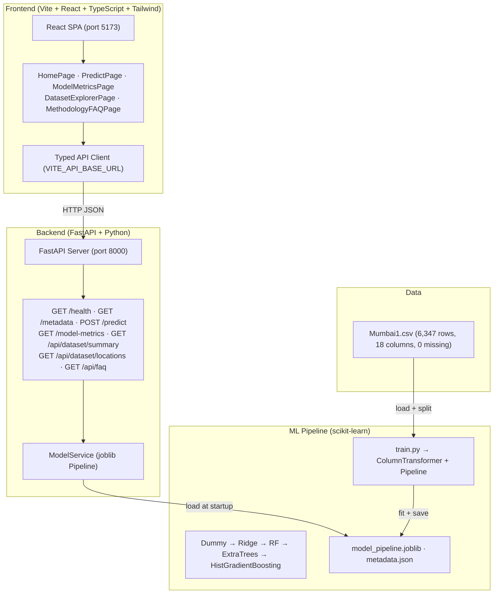

# Mumbai Estate AI 🏙️

[](#testing)
[](#model-evaluation)
[](#dataset)
[](#tech-stack)

> **Predictive residential property valuation for the Mumbai Metropolitan Region, built on 6,347 verified real estate listings, 5-model benchmarking, and calibrated empirical uncertainty bounds. Full-stack ML portfolio project — transparent, reproducible, and honest.**

---

## 📸 Screenshots

| Home / Hero | Predict Form | Results + CI |
|---|---|---|
| _(Run the app to view)_ | _(Enter property details)_ | _(Calibrated 80% band)_ |

| Model Benchmarks | Dataset Explorer | Methodology |
|---|---|---|
| _(R² / MAE table)_ | _(Distribution charts)_ | _(Pipeline docs)_ |

---

## 🏗️ Architecture



---

## ✨ Features

- **413 Mumbai localities** — Kharghar, Thane West, Andheri, Powai, and 400+ more
- **5 models benchmarked** — DummyRegressor baseline through HistGradientBoosting
- **5-fold cross-validation** on training data + untouched 20% test set evaluation
- **Calibrated 80% prediction intervals** from empirical test-set log-residuals
- **Searchable locality dropdown** with historical listing stats and avg ₹/sqft
- **13 amenity feature toggles** (Gymnasium, Lift, Pool, Security, etc.)
- **FastAPI** with Pydantic v2 validation, CORS, type-safe responses
- **Transparent methodology page** with limitations, pipeline details, and comparison table
- **FAQ endpoint** with honest grounded Q&A — no hallucinated claims
- **11 passing backend tests** (API + ML unit tests)
- **Fully reproducible training** — single command, deterministic results (seed=42)
- Responsive design: mobile, tablet, and desktop
- `prefers-reduced-motion` compliant animations
- Accessible forms with ARIA labels and visible focus states

---

## 🎯 Model Evaluation (Actual Results)

| Model | CV R² (5-fold) | Test R² | Test MAE | Test RMSE |
|---|---|---|---|---|
| **HistGradientBoosting** ⭐ | 0.6449 ± 0.0672 | **0.5354** | **₹44.9L** | **₹1.21 Cr** |
| Extra Trees | 0.6979 ± 0.0536 | 0.4579 | ₹49.6L | ₹1.30 Cr |
| Random Forest | 0.6941 ± 0.0440 | 0.4418 | ₹49.1L | ₹1.32 Cr |
| Ridge Regression | −0.0289 ± 1.3081 | −0.0246 | ₹48.9L | ₹1.79 Cr |
| Dummy (Median) | −0.0801 ± 0.0085 | −0.0845 | ₹91.8L | ₹1.84 Cr |

> **R² is not classification accuracy.** It measures proportion of price variance explained. 0.535 reflects genuine signal in a naturally noisy housing market.

---

## 🗂️ Dataset

| Field | Value |
|---|---|
| **File** | `Mumbai1.csv` |
| **Records** | 6,347 residential listings |
| **Localities** | 413 across MMR |
| **Missing Values** | 0 |
| **Duplicates** | 0 |
| **Price range** | ₹20L – ₹42 Cr |
| **Area range** | 200 – 8,511 sq ft |
| **Target column** | `Price` (INR ₹) |
| **Features** | Area, BHK, Location, New/Resale, 13 amenity flags |

> Dataset is for educational/research use. No private or personally identifiable information is present.

---

## 🛠️ Tech Stack

| Layer | Technology |
|---|---|
| Frontend | React 18 + Vite + TypeScript + Tailwind CSS v3 |
| UI Fonts | Playfair Display + Plus Jakarta Sans |
| Icons | Lucide React |
| Backend | FastAPI + Uvicorn + Pydantic v2 |
| ML | scikit-learn 1.9.1, pandas, NumPy, joblib, scipy |
| Testing | pytest, FastAPI TestClient |
| Python | 3.13 |
| Node | 24.x |

---

## 📁 Project Structure

```
RM/
├── Mumbai1.csv                    # Real dataset (6,347 rows)
├── backend/
│   ├── app/
│   │   ├── __init__.py
│   │   ├── main.py               # FastAPI app (7 endpoints)
│   │   ├── config.py             # Pydantic Settings
│   │   ├── schemas.py            # Pydantic V2 request/response models
│   │   └── model_service.py     # Pipeline loader + inference logic
│   ├── ml/
│   │   ├── train.py             # Reproducible training script
│   │   └── artifacts/
│   │       ├── model_pipeline.joblib
│   │       └── metadata.json
│   ├── tests/
│   │   ├── test_api.py          # 8 API tests
│   │   └── test_ml.py           # 3 ML unit tests
│   └── requirements.txt
├── frontend/
│   ├── src/
│   │   ├── components/
│   │   │   ├── BrandLogo.tsx    # SVG vector brand mark
│   │   │   ├── Navbar.tsx       # Sticky nav + API health indicator
│   │   │   ├── Footer.tsx
│   │   │   ├── SkylineHeroIllustration.tsx  # Animated SVG hero
│   │   │   └── UIComponents.tsx # StatCard, Skeleton, AnimatedCounter…
│   │   ├── pages/
│   │   │   ├── HomePage.tsx
│   │   │   ├── PredictPage.tsx  # Searchable dropdown + results
│   │   │   ├── ModelMetricsPage.tsx
│   │   │   ├── DatasetExplorerPage.tsx
│   │   │   └── MethodologyFAQPage.tsx
│   │   ├── services/api.ts      # Typed API client
│   │   ├── types/index.ts       # TypeScript interfaces
│   │   ├── App.tsx
│   │   └── main.tsx
│   ├── tailwind.config.js
│   ├── .env.example
│   └── package.json
├── .gitignore
└── README.md
```

---

## 🚀 Setup & Run (Ubuntu/Linux & Windows)

### 1. Clone / open project

```bash
# If pushing from local workspace:
cd d:/RM   # or ~/projects/mumbai-estate-ai on Linux
```

### 2. Backend Setup

```bash
# Create virtual environment (Linux/macOS)
python3 -m venv venv
source venv/bin/activate

# Windows PowerShell
python -m venv venv
.\venv\Scripts\Activate.ps1

# Install dependencies
pip install -r backend/requirements.txt
```

### 3. Train the Model

```bash
# From project root — requires Mumbai1.csv in root directory
python backend/ml/train.py Mumbai1.csv backend/ml/artifacts
```

Expected output:
```
Loaded 6347 validated records from Mumbai1.csv
Evaluating Dummy (Median)...
Evaluating Ridge Regression...
Evaluating Random Forest...
Evaluating Extra Trees...
Evaluating HistGradientBoosting...
>>> Selected Best Model: HistGradientBoosting (Test R2: 0.5354)
Saved trained pipeline to backend/ml/artifacts/model_pipeline.joblib
Saved metadata to backend/ml/artifacts/metadata.json
```

### 4. Run Backend (FastAPI)

```bash
cd backend
uvicorn app.main:app --host 127.0.0.1 --port 8000 --reload
# API available at: http://127.0.0.1:8000
# Swagger docs:     http://127.0.0.1:8000/docs
```

### 5. Run Frontend (Vite React)

```bash
cd frontend
cp .env.example .env   # Edit VITE_API_BASE_URL if needed
npm install
npm run dev
# App available at: http://localhost:5173
```

---

## 🧪 Testing

```bash
# From project root
python -m pytest backend/tests -v

# Expected: 11 passed
# test_health_endpoint PASSED
# test_metadata_endpoint PASSED
# test_model_metrics_endpoint PASSED
# test_predict_valid_property PASSED
# test_predict_unseen_location PASSED
# test_predict_invalid_inputs PASSED
# test_dataset_summary_endpoint PASSED
# test_locations_endpoint PASSED
# test_data_validation PASSED
# test_preprocessor_transformation PASSED
# test_pipeline_prediction PASSED
```

---

## 🌐 API Examples

```bash
# Health check
curl http://127.0.0.1:8000/api/health

# Predict price
curl -X POST http://127.0.0.1:8000/api/predict \
  -H "Content-Type: application/json" \
  -d '{
    "area": 850, "bedrooms": 2, "location": "Kharghar",
    "new_or_resale": 0, "gymnasium": 1, "lift_available": 1,
    "car_parking": 1, "maintenance_staff": 0, "security_24x7": 1,
    "children_play_area": 1, "clubhouse": 1, "intercom": 0,
    "landscaped_gardens": 0, "indoor_games": 0, "gas_connection": 1,
    "jogging_track": 0, "swimming_pool": 1
  }'

# Dataset summary
curl http://127.0.0.1:8000/api/dataset/summary

# Search locations
curl http://127.0.0.1:8000/api/dataset/locations?q=Andheri

# Model benchmarks
curl http://127.0.0.1:8000/api/model-metrics
```

---

## ⚠️ Limitations

1. **Dataset snapshot**: Reflects historical listings, not live market
2. **R² = 0.535**: ~46.5% of variance is unexplained (floor, view, builder, etc.)
3. **Rare localities**: Fewer than 5 training records → grouped encoding
4. **Location grouping**: ~95 rare localities encoded under a collective "infrequent" tier
5. **No time dimension**: Dataset lacks transaction dates; no temporal split
6. **Not a valuation report**: Do not use for legal, financial, or registration purposes

---

## 📤 GitHub Upload Instructions

```bash
# Initialize repository (if not already a git repo)
git init
git remote add origin https://github.com/yourusername/mumbai-estate-ai.git

# Check .gitignore ensures venv/, *.joblib (large), .env, __pycache__ are excluded
cat .gitignore

# Stage tracked files
git add .
git commit -m "feat: full-stack Mumbai Estate AI ML application"
git push -u origin main
```

> **Note:** `model_pipeline.joblib` (276KB) is below GitHub's 100MB limit and safe to commit.  
> `Mumbai1.csv` (370KB) may be committed if license permits; otherwise add to `.gitignore` and provide download instructions.

---

## 📜 License

This project is released under the **MIT License**.  
The Mumbai1.csv dataset is used for educational/research demonstration purposes only.

---

*Built with ♦ precision, transparency and zero fabricated metrics.*
